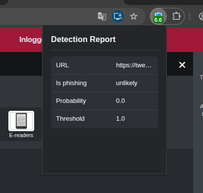
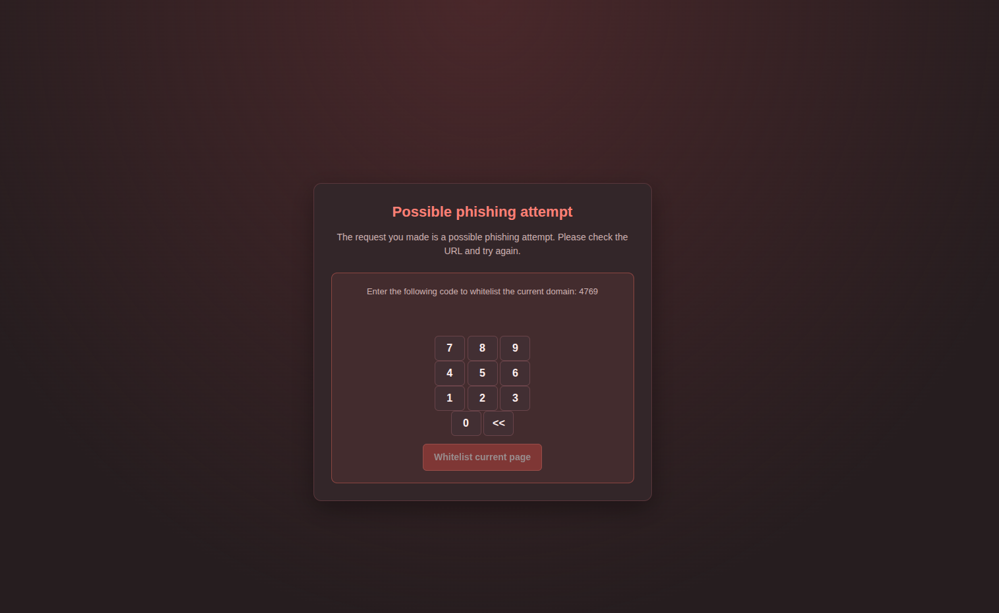

# Phishing Detection Plugin for Chrome and Firefox

_A modular phishing detection plugin for Chrome and Firefox_

## Screenshots

 
 

## Installation

If applicable, install this plugin by using the [Chrome Web Store](https://chromewebstore.google.com/detail/phishing-detection-plugin/nadlnglpibiemkeoonbdbamcacghdiak) or the [Firefox Extension Store](https://addons.mozilla.org/en-US/firefox/addon/phishing-detection-plugin/).

## Manual installation (for testing purposes only)

- For Chrome, get the latest automated crx build from
  the [releases](https://github.com/YoeriNijs/phishing-detection-plugin/tree/main/release). Next, drag the crx file to
  the extension page to install the plugin.
- For Firefox, get the latest zip file from
  the [releases](https://github.com/YoeriNijs/phishing-detection-plugin/tree/main/release). Enable extension developer
  mode, unzip the file, and select the manifest.json to install it.

## Privacy

This plugin only uses the current web browser activity (browser url) to detect whether there is a possible phishing
attempt. All settings and activities are stored on your computer alone. We do not store and share any of your data.

## How to build

### Requirements

- Make sure you've installed [Node](https://nodejs.org/en) v22 or higher

### Steps

- Clone this repository
- Run `npm install` (make sure you've [Node](https://nodejs.org/en) or higher installed)
- Run `npm run build:chrome` for Chrome or `npm run build:firefox` for Firefox
- Build output is saved in the `/build` directory.

## Acknowledgement

- Icon: [Freepik](https://www.flaticon.com/free-icons/shield)
